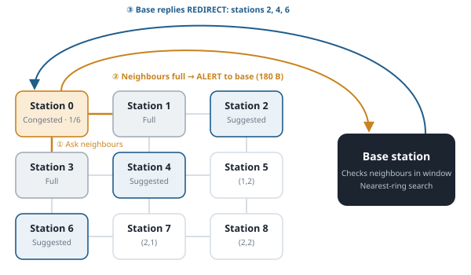
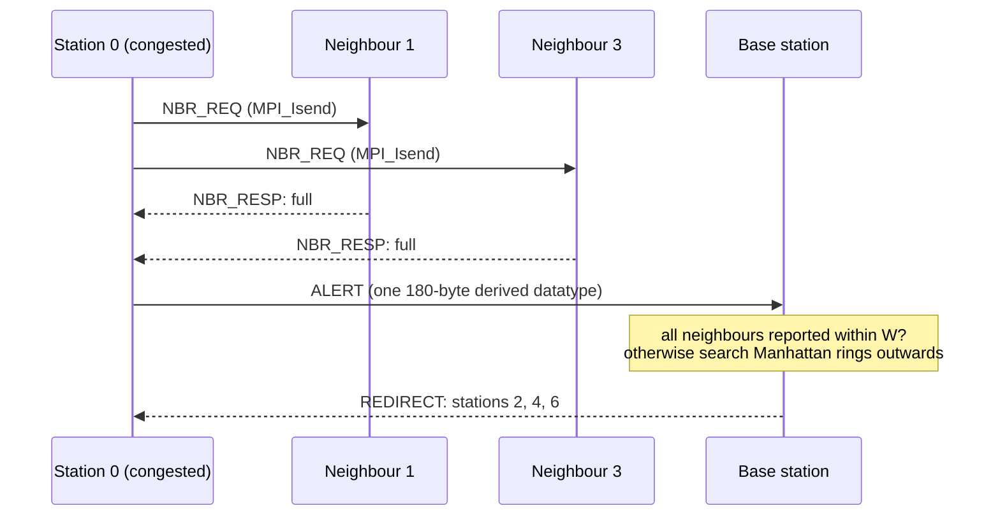
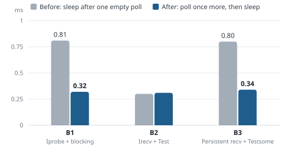

# Distributed EV Charging Network Simulation

A grid of electric-vehicle charging stations that coordinate like a wireless
sensor network, simulated with **Open MPI** and **OpenMP** in C. A congested
station first asks its neighbours for help; only when they are full too does
it ask a base station, which recommends the nearest stations with free ports.



## Highlights

- **One MPI process per station, one OpenMP thread per charging port.**
  Stations sit on a 2-D Cartesian topology; port threads each write only their
  own slot, so the shared state needs no locks.
- **Designs chosen by measurement.** Three station protocols and three base
  station designs were built and compared on a 6 × 6 grid (37 processes,
  3 hosts). The on-demand, non-blocking protocol cut messages per station per
  cycle from **3.39 to 1.97** and shutdown time from **277 ms to 84 ms**.
- **A latency bug found in the data.** Sleeping after a single empty poll
  missed messages that arrived during the poll. Polling once more before
  sleeping cut the median alert round trip from **0.81 ms to 0.32 ms**.
- **Tested like production code.** 32 integration tests run the real MPI
  program across every protocol pair, grid shapes, scenarios and bad input,
  plus a unit test of the base station's search. AddressSanitizer, UBSan and
  LeakSanitizer report no errors in this code.
- **400+ experiment runs** on a laptop and on a SLURM cluster (up to 5 nodes ×
  16 cores), with scripts that generate every table and figure from raw runs.

## Quick start

Requires Open MPI and a C compiler with OpenMP.

```bash
# macOS:  brew install open-mpi gcc
# Ubuntu: sudo apt install openmpi-bin libopenmpi-dev
make            # builds bin/wsn and bin/test_candidates
make demo       # a 3 x 3 grid + base station for 20 s, printing every decision
make test       # unit test + the 32-case integration suite
```

Sample output from `make demo`:

```text
[base t=  1.001s] alert #1 node 8 (2,2) free 0/6 -> suggest nearest available: 2(0,2) 4(1,1) 6(2,0)
[base t=  1.001s] alert #1 node 1 (0,1) free 1/6 -> suggest nearest available: 3(1,0)
[base t=  2.001s] alert #1 node 2 (0,2) free 1/6 -> no available node nearby
[base t=  3.001s] alert #3 node 8 (2,2) free 0/6 -> suggest nearest available: 4(1,1) 6(2,0)
```

Run any grid size directly; it needs `m × n + 1` processes:

```bash
mpirun --oversubscribe -np 10 bin/wsn 3 3 -c 1000 -t 60 -W 5 -o out/run
bin/wsn -h      # all options
```

| Option | Meaning | Default |
| --- | --- | --- |
| `m n` | grid rows and columns | `MPI_Dims_create` |
| `-k` | charging ports per station (OpenMP threads) | 6 |
| `-c` | port update and sampling cycle (ms) | 1000 |
| `-t` | simulation length (s), enforced by the base station | 30 |
| `-T` | a station is congested when free ports `< T` | 2 |
| `-W` | base station window W (s) | 5 |
| `-N` | station protocol 1 / 2 / 3 | 2 |
| `-B` | base station design 1 / 2 / 3 | 2 |
| `-p` | polling interval of the event loops (µs) | 200 |
| `-a -d` | arrival / departure probability per port per cycle | 0.5 / 0.3 |
| `-H -A -D` | "hot" stations (e.g. `0,1,3`) and their probabilities | – / 0.95 / 0.05 |
| `-C` | cool-down cycles after an episode | 2 |
| `-o` | output directory | `out` |
| `-l` | per-station logs on or off | 1 |

## How it works




- **Processes.** `MPI_Comm_split` separates the base station (the last world
  rank) from the stations. The stations build a non-periodic 2-D communicator
  with `MPI_Cart_create` and find neighbours with `MPI_Cart_shift`; missing
  neighbours are `MPI_PROC_NULL`.
- **Ports.** Each station runs an OpenMP team of `k + 1` threads. Thread 0 is
  the controller and the only thread that calls MPI (`MPI_THREAD_FUNNELED`);
  threads 1..k are ports, each updating its own slot of a shared array once
  per cycle with atomic writes. The controller samples the array every cycle
  and keeps a timestamped availability history.
- **Station protocol (N2, default).** When free ports drop below `T`, the
  station sends `NBR_REQ` to its neighbours and posts `MPI_Irecv` for the
  replies, never blocking. Requests from neighbours arrive on persistent
  receives and are answered with `MPI_Isend`. If any neighbour has space, EVs
  are redirected to the one with the most free ports; otherwise the station
  sends one `ALERT` carrying its own and every neighbour's availability, the
  messages exchanged and the exchange time.
- **Base station.** A single thread polls for alerts. If every neighbour of the
  reporter has also reported within the window `W`, it replies "no station
  available nearby". Otherwise it searches outwards in Manhattan rings
  (distance 2, 3, …) and returns **all** stations on the nearest ring not known
  to be busy.
- **Graceful shutdown.** After `-t` seconds the base sends `TERMINATE` and keeps
  answering alerts until every station has sent its `FINAL` statistics.
  Stations finish any open exchange, wait in `MPI_Ibarrier` while still serving
  neighbours, retire persistent receives with `MPI_Cancel`, join their port
  threads and free every communicator and buffer.

### Protocol variants compared

| Station | Mechanism |
| --- | --- |
| N1 | `MPI_Sendrecv` with the 4 neighbours every cycle; blocking sends to the base; `MPI_Allreduce` to agree on termination |
| **N2** | on demand and non-blocking (`MPI_Isend`/`MPI_Irecv`, persistent receives, `MPI_Testsome`/`MPI_Testall`) |
| N3 | `MPI_Neighbor_allgather` on the Cartesian communicator every cycle |

| Base station | Mechanism |
| --- | --- |
| B1 | `MPI_Iprobe` + blocking `MPI_Recv`; blocking replies |
| **B2** | one pre-posted `MPI_Irecv` + `MPI_Test`; replies with `MPI_Isend` |
| B3 | 16 persistent receives (`MPI_Recv_init`, `MPI_Startall`), batch `MPI_Testsome` |

## Results

Measured on the cluster, 6 × 6 grid, 37 processes across 3 hosts:

| Station protocol | Neighbour exchange, median | Messages per station per cycle | Shutdown |
| --- | --- | --- | --- |
| N1 blocking, every cycle | 0.29 ms | 3.39 | 277 ms |
| **N2 non-blocking, on demand** | 0.42 ms | **1.97** | **84 ms** |
| N3 neighbourhood collective | 0.19 ms | 3.39 | 279 ms |

N1 and N3 look fast on the median only because every station meets at the
cycle edge; on shared cores one blocked station stalls its neighbours (p95 up
to 21 ms in local runs). N2 sends the fewest messages and shuts down 3.3 times
faster, so it is the default.



Scaling from 3 × 3 to 8 × 8 on the cluster: the neighbour exchange stays
nearly flat up to 6 × 6, because each station has at most four neighbours, and
doubles at 8 × 8, where 21% of neighbour links cross hosts. Shutdown grows with
the number of stations, since the single base station handles one round trip
per station.

| Grid | Stations | Neighbour exchange, median | Alert round trip, median | Shutdown, median |
| --- | --- | --- | --- | --- |
| 3 × 3 | 9 | 0.27 ms | 0.27 ms | 57 ms |
| 4 × 4 | 16 | 0.36 ms | 0.56 ms | 57 ms |
| 5 × 5 | 25 | 0.34 ms | 0.36 ms | 78 ms |
| 6 × 6 | 36 | 0.39 ms | 0.32 ms | 86 ms |
| 8 × 8 | 64 | 0.59 ms | 0.57 ms | 87 ms |

Every table and figure in [`results/`](results) is generated by
`scripts/analyse.py` from raw runs: `results/local` holds the 33 grid shapes,
35 line lengths and parameter sweeps run on a laptop, and `results/cluster` the
SLURM runs.

## Testing

```bash
make test         # unit test + 32 integration cases (about 2 minutes)
make test-quick   # unit test + a short subset
make asan         # AddressSanitizer + UBSan build (Linux)
```

- `tests/test_candidates.c` unit-tests the nearest-ring search, including the
  reference 3 × 3 case (station 0 reports, 1 and 3 are busy → 2, 4, 6).
- `tests/run_tests.py` launches the real MPI program for all 9 protocol pairs,
  shapes from 1 × 1 to 4 × 5, three scenarios (neighbour has space, base
  suggests candidates, everything saturated) and invalid input, and checks
  exit codes, deadlocks and the base station's statistics.
- `jobs/memcheck.job` runs the sanitizer build; leaks reported inside Open MPI
  itself are suppressed with `tests/lsan_openmpi.supp`.

## Running experiments

```bash
python3 -I scripts/make_cases.py --best "-N 2 -B 2"     # writes jobs/cases/*.txt
LAUNCHER="mpirun --oversubscribe" RAW=out/raw \
    bash scripts/run_cases.sh jobs/cases/local_2_scaling.txt
python3 -I scripts/analyse.py out/raw out/analysis       # tables + figures
```

On a SLURM cluster, `jobs/test.job`, `jobs/run_caas.job` and
`jobs/memcheck.job` run the test suite, the scaling and protocol experiments,
and the sanitizer check; adjust the partition and module names for your site.
Runs are time-compressed (a 200 ms cycle stands for a 10 s update period) so
hundreds fit in a 20-minute job, and every run logs the binary's checksum.

## Project layout

```text
src/        main.c util.c node.c base.c base_logic.c common.h
tests/      run_tests.py  test_candidates.c  lsan_openmpi.supp
scripts/    make_cases.py run_cases.sh analyse.py demo_local.sh demo_cluster.sh
jobs/       SLURM job files and generated case lists
results/    tables, figures and scaling fits (local and cluster)
docs/       diagrams used in this README
```

## Authors

Yiyou Xu (design, implementation, experiments and analysis), with contributions from Jiang.

## License

[MIT](LICENSE)
